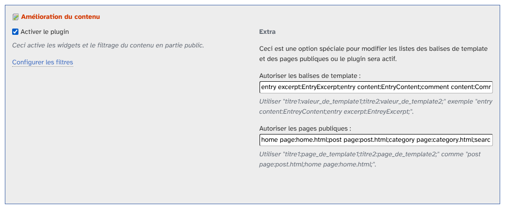
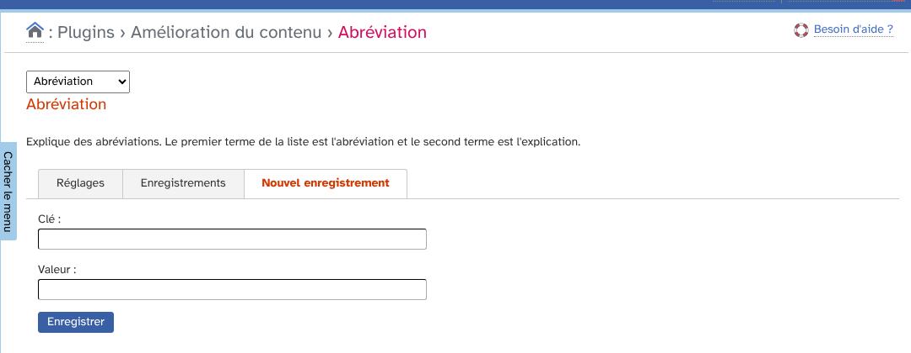
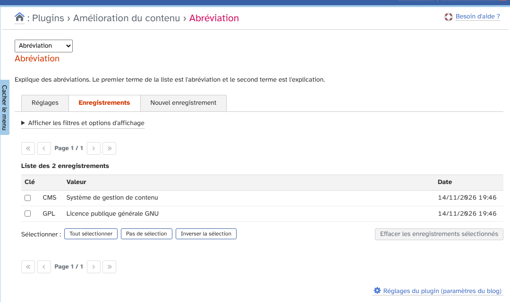
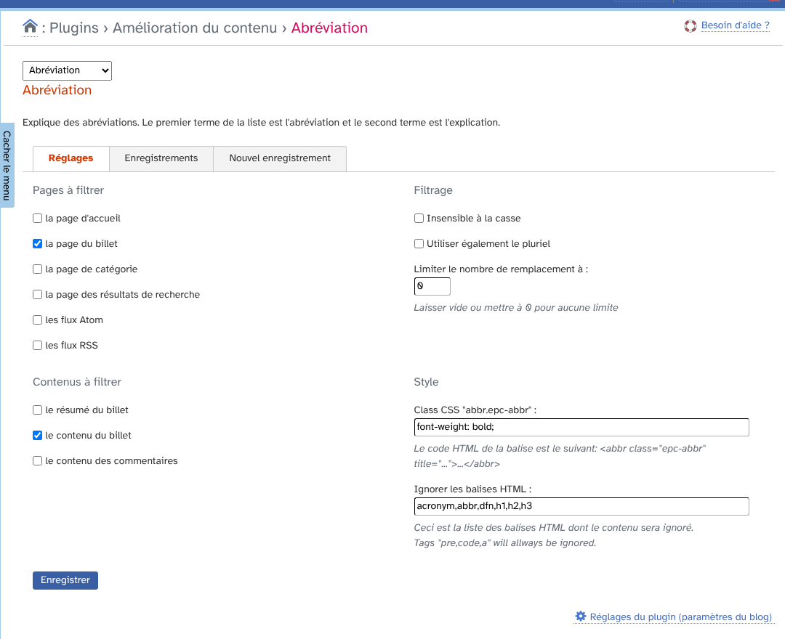
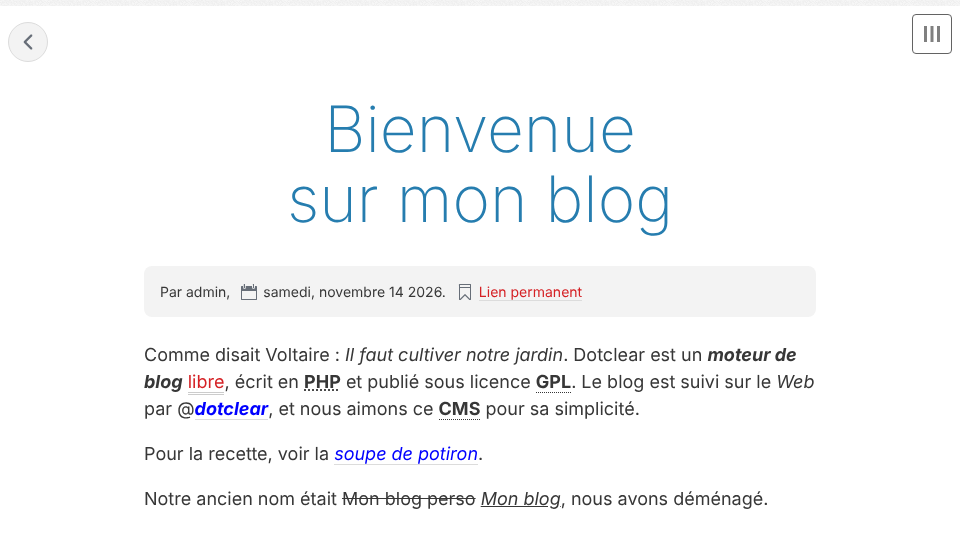
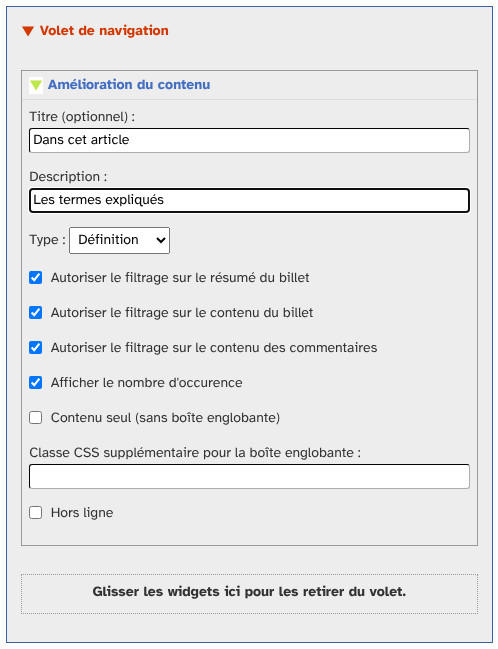
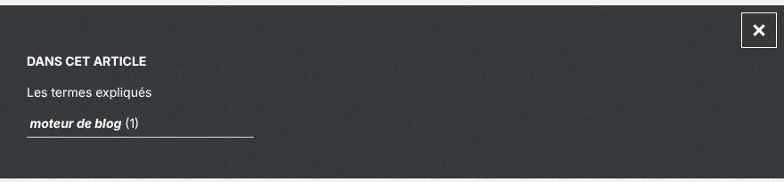

# enhancePostContent : guide d'utilisation

enhancePostContent (« Amélioration du contenu » dans l'administration) enrichit automatiquement le texte de vos billets.
Vous donnez une liste de mots, et le plugin les transforme à l'affichage : une abréviation explique son sens, un mot devient un lien, une citation est mise en valeur.
Le texte que vous avez écrit n'est pas modifié : tout se fait au moment où le billet s'affiche.

## Sommaire

* [Activer le plugin](#activer-le-plugin)
* [Les filtres](#les-filtres)
* [Ajouter des mots à un filtre](#ajouter-des-mots-à-un-filtre)
* [Régler un filtre](#régler-un-filtre)
* [Le résultat sur le blog](#le-résultat-sur-le-blog)
* [Le widget](#le-widget)
* [Avec un assistant IA](#avec-un-assistant-ia)

## Activer le plugin

Ouvrez le menu « Blog », puis « Paramètres du blog ».
Dans « Paramètres des plugins pour ce blog », cochez « Activer le plugin » dans le bloc « Amélioration du contenu », puis enregistrez.

Tant que la case est décochée, rien n'est filtré et le widget n'apparaît pas.
Le lien « Configurer les filtres » mène à la page du plugin.

## Les filtres

Ouvrez le menu « Plugins », puis « Amélioration du contenu ».
La liste en haut de la page permet de choisir le filtre à régler.
Chaque filtre a sa propre liste de mots et ses propres réglages.

* **Abréviation** : le mot reçoit une bulle qui donne son sens complet.
* **Acronyme** : comme l'abréviation, avec la balise « acronym ».
* **Citation** : une phrase est mise en valeur, avec le nom de son auteur en bulle.
* **Définition** : un mot reçoit une bulle qui donne sa définition.
* **Lien** : un mot ou une expression devient un lien vers l'adresse de votre choix.
* **Remplacement** : un texte est remplacé par un autre.
* **Mise à jour** : l'ancien terme est barré et le nouveau est affiché à côté.
* **Mot-clé** : les mots qui sont des mots-clés de votre blog deviennent des liens vers leur page.
* **Twitter** : chaque nom précédé de « @ » devient un lien vers la page de cet utilisateur.
* **Recherche** : met en valeur les mots cherchés par un visiteur dans les résultats de recherche.

Les filtres Mot-clé, Twitter et Recherche n'ont pas de liste de mots : ils agissent seulement avec leurs réglages.
Le filtre Mot-clé demande que le plugin Mots-clés soit actif.

## Ajouter des mots à un filtre

Les autres filtres ont deux onglets en plus des réglages : « Enregistrements » et « Nouvel enregistrement ».

Pour ajouter un mot, ouvrez « Nouvel enregistrement », remplissez la **clé** et la **valeur**, puis enregistrez.

La clé est le mot à trouver dans vos billets.
La valeur dépend du filtre :

| Filtre | Clé | Valeur |
| --- | --- | --- |
| Abréviation, Acronyme, Définition | le mot | son explication |
| Citation | la phrase | son auteur |
| Lien | le texte à lier | l'adresse du lien |
| Remplacement | le texte à remplacer | le texte de remplacement |
| Mise à jour | l'ancien terme | le nouveau terme |

L'onglet « Enregistrements » liste les mots déjà saisis.
Pour en supprimer, cochez-les puis cliquez sur « Effacer les enregistrements sélectionnés ».

Le même couple clé et valeur ne peut pas être ajouté deux fois dans un filtre.

## Régler un filtre

L'onglet « Réglages » de chaque filtre décide où et comment il agit.

* **Pages à filtrer** : la page d'accueil, la page du billet, les catégories, les résultats de recherche ou les flux.
* **Contenus à filtrer** : le résumé du billet, son contenu ou les commentaires.
* **Insensible à la casse** : « blog » trouve aussi « Blog ».
* **Utiliser également le pluriel** : « blog » trouve aussi « blogs ».
* **Limiter le nombre de remplacement** : un mot n'est transformé que ce nombre de fois. Laissez 0 pour ne pas limiter.
* **Style** : le style CSS appliqué aux mots transformés, par exemple `font-weight: bold;`.
* **Ignorer les balises HTML** : le contenu de ces balises n'est jamais transformé.

Les réglages sont propres à chaque filtre : enregistrez-les avec le bouton « Enregistrer » de l'onglet.

## Le résultat sur le blog

Voici un billet dont le texte brut ne contient aucune balise spéciale.
Les filtres ont ajouté une citation, une définition, un mot-clé, un acronyme, une abréviation, un remplacement, un lien et une mise à jour.

Les bulles apparaissent quand le visiteur passe la souris sur un mot.

## Le widget

Le widget « Amélioration du contenu » liste, sur la page d'un billet, les mots d'un filtre qui apparaissent dans ce billet.

1. Ouvrez le menu « Widgets ».
2. Glissez « Amélioration du contenu » dans un volet.
3. Choisissez le **Type**, c'est-à-dire le filtre à lister, et les contenus à analyser.
4. Enregistrez.

Les réglages du widget :

* **Titre** et **Description** : le titre du bloc et un texte facultatif ;
* **Type** : le filtre à lister ;
* **Autoriser le filtrage sur…** : les contenus du billet à analyser ;
* **Afficher le nombre d'occurence** : ajoute, entre parenthèses, le nombre de fois où le mot apparaît ;
* **Contenu seul**, **Classe CSS** et **Hors ligne** : les réglages habituels des widgets.

Le widget n'apparaît que sur la page d'un billet ou d'une page, et seulement s'il y trouve des mots.

## Avec un assistant IA

Avec le plugin [ClaudetteMcp](https://github.com/JcDenis/ClaudetteMcp), un assistant IA connecté au blog peut gérer les mots des filtres
qui ont une liste (acronymes, abréviations, définitions, liens, remplacements…), si le plugin est activé et si vous êtes administrateur de contenu :

* `list_enhanced_terms` : lister les mots, filtre par filtre ;
* `set_enhanced_term` : ajouter un mot à un filtre, ou modifier un mot.

Par exemple : « ajoute l'acronyme MCP, Model Context Protocol ». L'assistant ne supprime jamais de mot
et ne change pas les réglages des filtres. _ClaudetteMcp_ n'est pas nécessaire au fonctionnement d'_enhancePostContent_.
